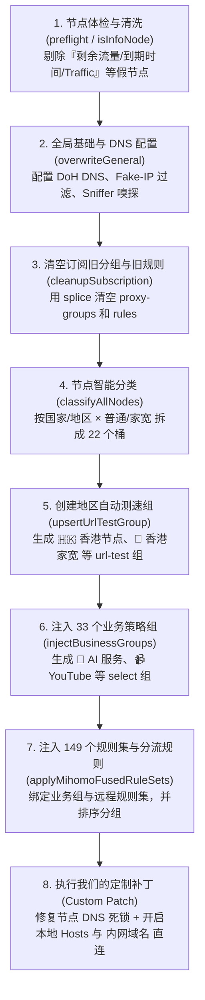

# FlClash / Mihomo 覆写脚本从入门到精通指南

这份文档带你从零看懂 [`dist/FlClash.js`](../dist/FlClash.js)（约 1750 行）以及自动化打补丁脚本 [`scripts/build.js`](../scripts/build.js) 的完整原理。读完后，你不仅能看懂现有脚本，还能自己动手编写或修改任意规则与分组。

---

## 一、一句话理解：什么是「覆写脚本」？

平时你导入机场订阅时，机场给你的是一个巨大的 **YAML 配置文件**（里面写着有哪些节点、哪些分组、哪些规则）。

**覆写脚本（Override Script）的本质就是一个 JavaScript 过滤器**：
当 FlClash 加载订阅时，它会先把机场的 YAML 转换成一个 JavaScript 对象 `config`，然后调用你写的 `main(config)` 函数，最后把你 `return` 出来的 `config` 交给内核运行：


最简单的覆写脚本只有 4 行：

```javascript
function main(config) {
  // 在这里对 config 对象进行增删改
  return config;
}
```

---

## 二、看懂脚本前，先认识 `config` 里的「五大金刚」

不管脚本写到 100 行还是 2000 行，它操作的永远是 `config` 对象里的这 **5 个核心属性**：

| 属性名 | 类型 | 作用通俗解释 |
| :--- | :--- | :--- |
| **`config.proxies`** | 数组 `Array` | **【原料：节点列表】** 机场提供的每一台服务器（如“香港 01”、“日本 02”），也常混着“剩余流量：100GB”这种假节点。 |
| **`config['proxy-groups']`** | 数组 `Array` | **【车间：策略组】** 把上面的节点打包成组。常见两种类型：<br>1. `url-test`（自动测速组，如 `🇭🇰 香港节点`，自动挑延迟最低的节点）<br>2. `select`（手动选择组，如 `🤖 AI 服务`，让你在界面上点选走哪个地区组或节点） |
| **`config['rule-providers']`** | 对象 `Object` | **【外部规则字典】** 从网上下载的域名/IP 列表文件（比如包含几千个 AI 网站域名的 `.mrs` 文件）。 |
| **`config.rules`** | 数组 `Array` | **【交通指挥员：分流规则】** 从上往下按顺序匹配流量。比如 `"DOMAIN-SUFFIX,internal.example.com,DIRECT"` 表示该域名直接连接，不走代理。**排在越前面优先级越高！** |
| **`config.dns` & `config.sniffer`** | 对象 `Object` | **【导航仪：DNS 与嗅探】** 决定域名怎么解析成 IP，以及是否启用本地 `/etc/hosts`、Fake-IP（假 IP）和流量域名嗅探。 |

---

## 三、⚠️ FlClash 写脚本头号铁律：数组必须「原地修改」

在阅读 `FlClash.js` 时，你会发现很多地方清理数组不写 `config.rules = []`，而是写：

```javascript
// ❌ 错误写法（在 FlClash 中会导致修改丢失！）
config.rules = ["DOMAIN-SUFFIX,baidu.com,DIRECT"];

// ✅ 正确写法（原地修改原数组）
config.rules.splice(0, config.rules.length); // 先清空原数组
config.rules.push("DOMAIN-SUFFIX,baidu.com,DIRECT"); // 再往原数组里塞数据
// 或者往最前面插：
config.rules.unshift("DOMAIN-SUFFIX,internal.example.com,DIRECT");
```

**为什么？**
因为 FlClash 是用 Flutter (Dart) 写的，而 JS 脚本跑在内置的 QuickJS 引擎里。Dart 端手里握着 `config.proxies`、`config['proxy-groups']`、`config.rules` 这几个数组的**原始内存地址引用**。如果你用 `= []` 重新赋值了一个新数组，Dart 端拿到的还是旧数组，你的修改就会失效！

---

## 四、全景拆解：`dist/FlClash.js` 的 8 步执行流水线

打开 [`dist/FlClash.js`](../dist/FlClash.js)，直接翻到最底部的 `function main(config)`（第 1632 行），你会发现整个脚本其实只按顺序干了以下 **8 件事**：



下面我们逐一对照代码看懂每一块是怎么写的：

---

### 第 1 块：过滤机场里的「假节点」（第 163~338 行）

机场经常在节点列表里塞一些提示信息（比如 `"剩余流量 80GB"`、`"Traffic: 3.3 GB | 150 GB"`、`"距离下次重置 15 天"`）。如果不剔除，自动测速组可能会选中它们导致断网。

脚本用关键词数组 + 正则表达式识别它们：

```javascript
var INFO_TEXT = ['导航网址', '距离下次重置', '剩余流量', '套餐到期', '官网', ...];
var INFO_RE = /\b(?:TRAFFIC|USE|USED|TOTAL|EXPIRE|EMAIL|...)\b/i;

function isInfoNode(name) {
  // 如果节点名字包含 INFO_TEXT 里的词，或者匹配 INFO_RE 正则，就返回 true（代表是假节点）
  for (var i = 0; i < INFO_TEXT.length; i++) {
    if (name.indexOf(INFO_TEXT[i]) !== -1) return true;
  }
  return INFO_RE.test(name);
}
```

同理，脚本还用正则识别哪些节点是**家宽/专线节点**：

```javascript
const RESIDENTIAL_PATTERNS = [
  /家宽|家庭宽带|住宅/,
  /\bisp\b/i,
  /\biplc\b/i,
  /\biepl\b/i,
  /专线/,
];
```
只要节点名带有 `IEPL`、`专线`、`家宽`，`isResidentialNode(name)` 就会返回 `true`。

---

### 第 2 块：把节点按「国家/地区」自动归类（第 344~448 行）

为什么不管什么机场导入进来，脚本都能自动分出香港、台湾、日本、新加坡、美国？
因为脚本内置了一个地区词典 `REGION_DB`：

```javascript
const REGION_DB = [
  { id: 'HK', kw: ['香港', 'hong kong', 'hongkong', 'hkg', '港'], iso: ['HK'] },
  { id: 'TW', kw: ['台湾', '台北', 'taiwan', 'taipei', 'tpe'], iso: ['TW'] },
  { id: 'JP', kw: ['日本', '东京', '大阪', 'japan', 'tokyo'], iso: ['JP'] },
  { id: 'SG', kw: ['新加坡', 'singapore', 'sgp', 'sin'], iso: ['SG'] },
  { id: 'US', kw: ['美国', 'united states', 'usa', '洛杉矶', '圣何塞'], iso: ['US'] },
  // ...
];
```

然后 `classifyAllNodes(config.proxies)` 遍历所有真节点，把节点名字放进对应的分类桶里：
* 普通地区桶：`c.HK`、`c.TW`、`c.JP`、`c.SG`、`c.US`...
* 家宽/专线桶：`c.HOME_HK`、`c.HOME_TW`、`c.HOME_JP`...

---

### 第 3 块：创建地区自动测速组 `url-test`（第 576~581 行 & 1665~1693 行）

有了分类好的节点名单后，脚本调用 `upsertUrlTestGroup` 创建地区自动测速组：

```javascript
function upsertUrlTestGroup(config, name, proxies) {
  var group = {
    name: name,                              // 组名，例如 "🇭🇰 香港节点"
    type: 'url-test',                        // 类型：自动测速选最快节点
    url: 'https://www.gstatic.com/generate_204', // 测速用的探测地址
    interval: 300,                           // 每 300 秒测速一次
    tolerance: 10,                           // 延迟差距大于 10ms 才切换节点，防止频繁乱跳
    lazy: true,                              // 懒测速：只有用到该组时才测速，省流量
    proxies: proxies.slice()                 // 该地区下的所有节点名称数组
  };
  config['proxy-groups'].push(group);
}
```

而且脚本做了一个非常贴心的判断：**只有当某个地区的节点数量 `> 0` 时才创建该组**：
```javascript
if (c.HK.length > 0) upsertUrlTestGroup(config, SMART.HK, c.HK);
if (c.HOME_HK.length > 0) upsertUrlTestGroup(config, SMART.HK_HOME, c.HOME_HK);
```
这样如果你的机场没有非洲节点，界面上就不会出现空的 `🌍 非洲节点` 组。

---

### 第 4 块：创建 33 个业务策略组 `select`（第 587~646 行）

地区组是底层的“发动机”，而平时我们在面板上点选的是“业务策略组”（如 `🤖 AI 服务`、`📹 YouTube`、`🎥 Netflix`、`🏠 国内网站`）。

`injectBusinessGroups` 函数定义了这 33 个业务组，每个业务组的 `proxies` 候选列表引用的是上面创建的**地区组名称**：

```javascript
var groups = [
  { name: '🤖 AI 服务', type: 'select', proxies: ['🏡 美国家宽', '🏡 狮城家宽', '🇺🇸 美国节点', '🇸🇬 狮城节点', ...] },
  { name: '📹 YouTube', type: 'select', proxies: ['🌍 全球节点', '🇭🇰 香港节点', '🇹🇼 台湾节点', ...] },
  { name: '🏠 国内网站', type: 'select', proxies: ['DIRECT', '🌍 全球节点', ...] },
  { name: '🛑 广告拦截', type: 'select', proxies: ['REJECT', 'DIRECT'] },
  // ...
];
```
注意看：
* `🤖 AI 服务` 的第一位默认是家宽/外区组（因为 ChatGPT/Claude 对机房 IP 风控严）。
* `🏠 国内网站` 的第一位默认是 `DIRECT`（直连）。
* `🛑 广告拦截` 的第一位默认是 `REJECT`（直接拦截丢弃请求）。

---

### 第 5 块：注入 149 个远程规则集与 168 条分流规则（第 501~515 行）

业务组建好了，怎么知道哪些网站该走 `🤖 AI 服务`，哪些该走 `📹 YouTube` 呢？
靠的是 `MIHOMO_FUSED_RULE_PROVIDERS`（149 个远程规则集）和 `MIHOMO_FUSED_RULES`（168 条规则）：

1. **`rule-providers`（规则集字典）**：
   ```javascript
   "scki-fused-004-ai-domain": {
     "type": "http",
     "behavior": "domain",
     "format": "mrs", // Mihomo 专用的二进制高效规则格式
     "url": "https://raw.githubusercontent.com/.../scki-fused-004-ai-domain.mrs",
     "path": "./ruleset/v6.0.21/scki-fused-004-ai-domain.mrs",
     "interval": 86400, // 每 24 小时更新一次
     "proxy": "🚫 受限网站" // 通过「🚫 受限网站」策略组去下载该规则文件
   }
   ```
2. **`rules`（分流规则）**：
   ```javascript
   "RULE-SET,scki-fused-004-ai-domain,🤖 AI 服务",
   "RULE-SET,scki-fused-022-youtube-domain,📹 YouTube",
   // ...
   "MATCH,🐟 漏网之鱼" // 最后一条兜底规则：上面都没匹配到的流量，走「🐟 漏网之鱼」
   ```

---

### 第 6 块：我们打上去的定制补丁（第 1705~1732 行）

为什么原版脚本在你电脑上会出现**「本地 `/etc/hosts` 不生效」**？我们注入的极简通用补丁是怎么解决它的？

请看我们在 `sortProxyGroups(config)` 后面注入的代码，逐行解释：

```javascript
    // === [Custom Patch] 开启本地 Hosts 与内网开发直连 ===
    if (config.dns) {
      // 【补丁 1】开启读取系统本地 /etc/hosts（原版脚本第 1369 行写死了 false）
      config.dns["use-system-hosts"] = true;
    }

    // 【补丁 2：豁免内网目标 IP 的流量嗅探】
    // 原版脚本开启了 sniffer.override-destination = true。
    // 将所有内网网段加入 skip-dst-address，防止通过本地 hosts 解析出的内网 IP 被 Sniffer 重新还原成域名去查公网 DNS！
    if (config.sniffer) {
      if (!Array.isArray(config.sniffer["skip-dst-address"])) {
        config.sniffer["skip-dst-address"] = [];
      }
      ["127.0.0.0/8", "10.0.0.0/8", "172.16.0.0/12", "192.168.0.0/16"].forEach(function(cidr) {
        if (config.sniffer["skip-dst-address"].indexOf(cidr) === -1) {
          config.sniffer["skip-dst-address"].push(cidr);
        }
      });
    }

    // 【补丁 3：最高优先级内网直连规则】
    // 用 unshift 插到 rules 数组的最前面（第 0 位）。
    // 注意 IP-CIDR 故意不加 no-resolve，这样任何在 /etc/hosts 中指向内网 IP 的域名都会自动触发本地解析并走 DIRECT 直连！
    if (Array.isArray(config.rules)) {
      config.rules.unshift(
        "IP-CIDR,127.0.0.0/8,DIRECT",
        "IP-CIDR,10.0.0.0/8,DIRECT",
        "IP-CIDR,172.16.0.0/12,DIRECT",
        "IP-CIDR,192.168.0.0/16,DIRECT"
      );
    }
    // === [Custom Patch End] ===
```

---

## 五、看懂自动化构建脚本 [`scripts/build.js`](../scripts/build.js)

为了让你既能 100% 跟进上游原作者的规则和 DNS 更新，又不用每次手动去改 1700 行代码，我们写了 [`scripts/build.js`](../scripts/build.js)。它的逻辑非常清晰，只有 4 步：

1. **下载上游源码 (`fetchUrl`)**：
   用 `curl` 把上游 GitHub 仓库里的 `FlClash(mihomo).js`、`ClashParty(mihomo).js`、`ClashParty(mihomo-smart).js` 下载到内存中。
2. **定位锚点并注入补丁 (`applyPatches`)**：
   找到 `sortProxyGroups(config)` 这一行，把我们的 `buildPatchSnippet()` 本地 Hosts 补丁代码拼接到它下面。
3. **沙箱模拟运行自检 (`verifyPatchedScript`)**：
   使用 Node.js 内置的 `vm` 模块，构造一份模拟的机场订阅 `mockConfig`，真实跑一遍生成的 `main(mockConfig)`，自动检查：
   - `use-system-hosts` 是不是变成了 `true`？
   - 内网 `IP-CIDR` 直连规则是不是已经在 `rules` 里？
   只有全部检查通过，才允许写入文件，防止上游大改版导致生成的脚本报错。
4. **写入文件 (`dist/` 与原路径)**：
   把生成的脚本保存到 `dist/FlClash.js` 等目录，再由 GitHub Actions 自动推送到仓库。

---

## 六、动手速查表：以后你想改脚本时改哪里？

### 场景 1：我想强制某个公网网站（比如 `javdb.com`）走特定分组（比如 `🇯🇵 日韩节点`）
只需要在 `config.rules.unshift(...)` 里加一条规则：
```javascript
"DOMAIN-SUFFIX,javdb.com,🇯🇵 日韩节点",
```

### 场景 2：常用的 Clash 规则语法速查
* `DOMAIN-SUFFIX,google.com,策略组名`：匹配域名后缀（含 `google.com` 及 `mail.google.com`）
* `DOMAIN-KEYWORD,openai,策略组名`：只要域名里包含 `openai` 这几个字母就匹配
* `DOMAIN,www.example.com,策略组名`：精确匹配完整域名
* `IP-CIDR,192.168.0.0/16,DIRECT`：匹配目标 IP 网段（会先解析域名拿到 IP 再判断）
* `IP-CIDR,91.108.4.0/22,💬 即时通讯,no-resolve`：匹配目标 IP 网段（加了 `no-resolve` 表示只针对纯 IP 请求生效，不主动解析域名）
* `MATCH,🐟 漏网之鱼`：放在最后一行，匹配所有未命中的流量
